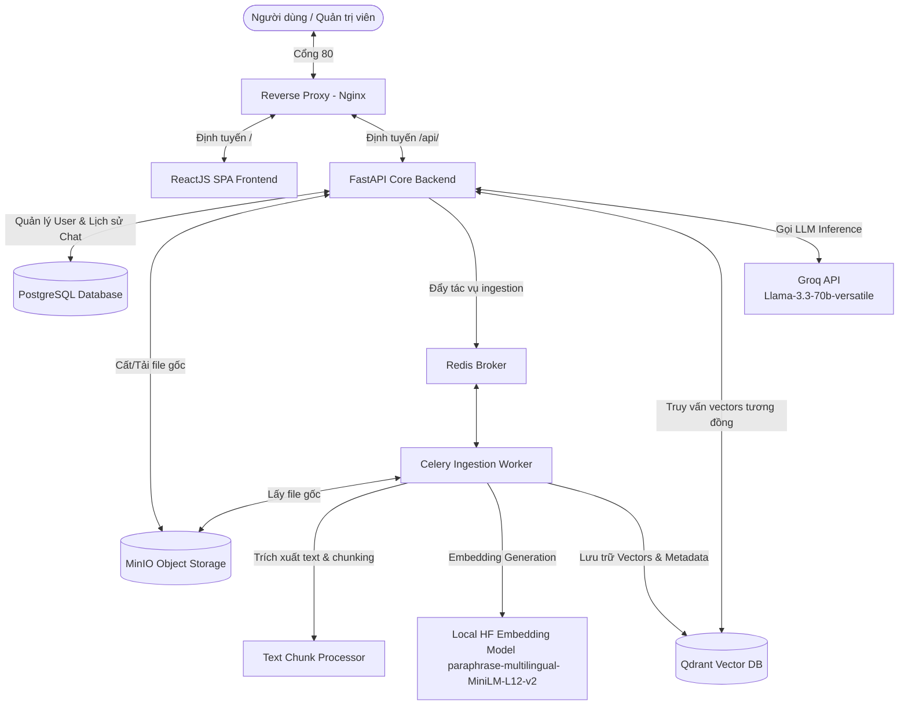
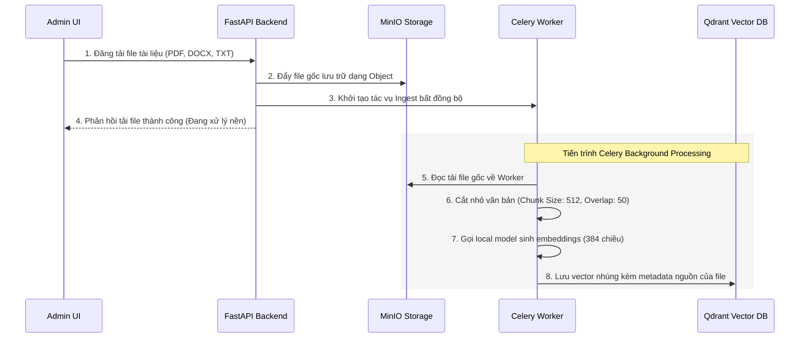
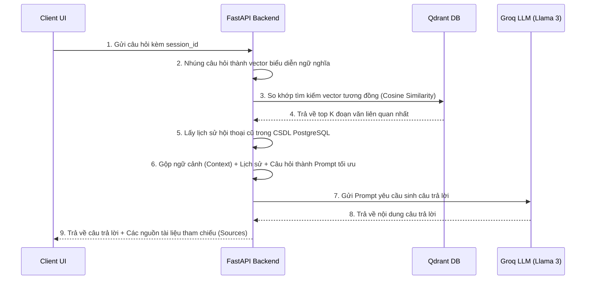

# 🦊 RAG Solution - Hệ thống Hỏi Đáp GitLab Handbook Microservices

Hệ thống Hỏi đáp (Q&A) thông minh dựa trên nội dung **GitLab Handbook**, sử dụng kiến trúc **RAG (Retrieval-Augmented Generation)** tiên tiến kết hợp sức mạnh của mô hình ngôn ngữ lớn (LLM) và cơ sở dữ liệu Vector. Dự án được phát triển dưới dạng **Microservices** chạy hoàn toàn trên Docker Container, tích hợp sẵn hệ thống **Admin Dashboard** quản trị chuyên sâu.

---

## 🏗️ Sơ Đồ Kiến Trúc Hệ Thống

Dưới đây là sơ đồ chi tiết luồng giao tiếp giữa các thành phần dịch vụ trong hệ thống thông qua Reverse Proxy **Nginx**:



---

## 🔌 Danh Sách Cổng Kết Nối (Ports Mapping)

Để phục vụ quản trị, kiểm tra và cấu hình các kết nối ngoại vi, hệ thống cung cấp các cổng dịch vụ sau:

| Thành phần Dịch vụ | Cổng ngoài (Host) | Cổng trong (Container) | Địa chỉ truy cập / Endpoint | Mô tả & Chức năng |
| :--- | :---: | :---: | :--- | :--- |
| **Nginx (Reverse Proxy)** | `80` | `80` | `http://localhost/` | **Cổng truy cập chính**. Tự động định tuyến giữa Frontend và Backend. |
| **Frontend (React)** | `3000` | `80` | `http://localhost:3000/` | Giao diện tương tác Chatbot & hệ thống quản trị Admin Dashboard. |
| **Backend (FastAPI)** | `8000` | `8000` | `http://localhost:8000/` | RESTful API dịch vụ Core, nơi điều phối dữ liệu và AI Engine. |
| **Swagger UI Docs** | `8000` | `8000` | `http://localhost:8000/docs` | Tài liệu hướng dẫn & công cụ kiểm thử API trực quan (FastAPI Docs). |
| **Qdrant Vector DB** | `6333` | `6333` | `http://localhost:6333/` | Lưu trữ vector nhúng của các mảnh văn bản tài liệu gốc. |
| **MinIO Console** | `9001` | `9001` | `http://localhost:9001/` | Web Dashboard quản lý tài liệu, file đính kèm lưu trữ dạng Object. |
| **MinIO API** | `9000` | `9000` | `http://localhost:9000/` | Cổng API Object Storage (tương thích S3) phục vụ lưu trữ file gốc. |
| **PostgreSQL Database** | `5432` | `5432` | `localhost:5432` | Hệ quản trị CSDL quan hệ lưu thông tin Người dùng & Phiên chat (Session). |
| **Redis Broker** | `6379` | `6379` | `localhost:6379` | Broker chuyển tiếp tin nhắn cho Celery Worker và làm bộ nhớ Cache. |

---

## 📂 Cấu Trúc Thư Mục Dự Án

Hệ thống được tổ chức dạng monorepo tối giản và nhất quán:

```text
thai-group-skibidi/
├── backend/                 # 🐍 FastAPI Backend & RAG Engine
│   ├── ai_engine/          # 🧠 Lớp xử lý AI (Embedding, Vector DB, Prompt Chain)
│   │   ├── embedding.py    # Khởi tạo mô hình Embedding cục bộ (HuggingFace)
│   │   ├── processor.py    # Xử lý cắt tài liệu (Chunking), làm sạch dữ liệu
│   │   ├── vector_db.py    # Quản trị kết nối và index trong Qdrant
│   │   └── rag_chain.py    # Triển khai RAG pipeline (Lấy context + Llama 3)
│   ├── app/                # 🛠️ FastAPI Application Core
│   │   ├── api/            # API Endpoints (Chat, History, Ingest, Upload, Admin)
│   │   │   ├── admin.py    # Các cổng API dành riêng cho trang quản trị Admin
│   │   │   ├── chat.py     # Cổng API xử lý hội thoại chatbot
│   │   │   ├── history.py  # Cổng API quản trị lịch sử phiên trò chuyện
│   │   │   ├── upload.py   # API tải file văn bản lên MinIO & Celery Ingest
│   │   │   └── ingest.py   # API tải file JSON Handbook định sẵn vào Qdrant
│   │   ├── core/           # Cấu hình biến môi trường, kết nối DB, Redis, MinIO
│   │   ├── models/         # Khai báo bảng CSDL (PostgreSQL Models: User, Message, Document)
│   │   ├── schemas/        # Định nghĩa cấu trúc truyền nhận dữ liệu (Pydantic)
│   │   ├── services/       # Xử lý logic nghiệp vụ
│   │   ├── tasks/          # Định nghĩa Celery Background Tasks
│   │   └── worker/         # Khởi tạo Celery worker instance
│   ├── main.py             # Điểm chạy chính của dịch vụ FastAPI Backend
│   ├── requirements.txt    # Danh sách thư viện Python
│   └── dockerfile          # File build container image backend
├── frontend/               # ⚛️ React SPA Frontend
│   ├── public/             # Thư mục chứa tài nguyên tĩnh
│   ├── src/                # Mã nguồn JavaScript của giao diện React
│   │   ├── components/     # Các thành phần giao diện nhỏ (Sidebar, Chat Window)
│   │   ├── services/       # Lớp gọi REST API kết nối đến Backend
│   │   ├── pages/          # Các trang giao diện chính
│   │   │   ├── Chat.jsx    # Trang chatbot người dùng tương tác
│   │   │   └── AdminDocuments.jsx # Giao diện Quản trị viên quản lý danh sách tài liệu
│   │   └── App.css         # CSS Styling cao cấp
│   ├── package.json        # Danh sách thư viện Node.js & scripts chạy
│   └── dockerfile          # File build container image Nginx chứa Frontend React
├── nginx/                  # 🌐 Cấu hình Reverse Proxy Nginx
│   └── default.conf        # Định tuyến cổng 80 cho các luồng request
├── data/                   # 💾 Lưu trữ dữ liệu bền vững qua Volume Mount
│   ├── postgres/           # Dữ liệu vật lý PostgreSQL
│   ├── qdrant/             # Dữ liệu vật lý Qdrant Vector DB
│   └── minio/              # Dữ liệu vật lý file gốc lưu trên MinIO
├── docker-compose.yml      # 🐳 File điều phối toàn bộ hệ thống microservices
├── .env.example            # Bản mẫu cấu hình biến môi trường
└── README.md               # Hướng dẫn chi tiết hệ thống (Hiện tại)
```

---

## ⚙️ Cấu Hình Biến Môi Trường (`.env`)

Sao chép tệp mẫu và điền đầy đủ các thông tin trước khi khởi chạy hệ thống:

```bash
cp .env.example .env
```

Các biến môi trường chính trong file `.env`:

* **`GROQ_API_KEY`**: *Bắt buộc*. Key API kết nối dịch vụ đám mây Groq Cloud để gọi mô hình Llama-3.3-70b siêu tốc.
* **`POSTGRES_DB` / `POSTGRES_USER` / `POSTGRES_PASSWORD`**: Cấu hình tên CSDL, tài khoản và mật khẩu của PostgreSQL (Mặc định: `rag_db` / `postgres` / `postgres`).
* **`QDRANT_API_KEY`**: Khóa bảo mật kết nối với Qdrant Vector Database (Mặc định: `qdrant_key`).
* **`REDIS_PASSWORD`**: Mật khẩu bảo vệ của Redis (mặc định để trống).
* **`REACT_APP_API_URL`**: Đường dẫn API Backend mà Frontend gọi tới (Mặc định: `http://localhost:8000`).

---

## 🚀 Hướng Dẫn Cài Đặt & Triển Khai Nhanh

Đảm bảo **Docker** & **Docker Desktop** đã được cài đặt và đang chạy trên thiết bị của bạn.

### Các bước thực hiện:

#### Bước 1: Clone dự án và điền file `.env`
```bash
git clone https://github.com/HoangQuocHung0605/THAI-Group-Skibidi.git
cd THAI-Group-Skibidi
cp .env.example .env
```
Mở tệp `.env` vừa sao chép và cập nhật khóa `GROQ_API_KEY` của bạn.

#### Bước 2: Triển khai các container bằng Docker Compose
Khởi chạy toàn bộ hệ thống microservices chỉ bằng một câu lệnh:
```bash
docker compose up -d --build
```
Hệ thống sẽ tiến hành tải hình ảnh các dịch vụ, cài đặt dependencies và thiết lập kết nối nội bộ giữa các container.

#### Bước 3: Truy cập hệ thống trải nghiệm
Sau khi quá trình khởi chạy hoàn tất thành công, bạn có thể truy cập:
* 🦊 **Giao diện Chat:** `http://localhost` (hoặc `http://localhost:3000`)
* 👑 **Hệ thống Quản trị (Admin):** `http://localhost/admin` (hoặc `http://localhost:3000/admin`)
* 📑 **Tài liệu API Swagger:** `http://localhost:8000/docs`
* 🗄️ **Quản trị lưu trữ MinIO:** `http://localhost:9001` (Tài khoản/Mật khẩu mặc định: `minioadmin` / `minioadmin`)

---

## 👑 Hệ Thống Quản Trị Admin Dashboard (`/admin`)

Hệ thống được thiết kế riêng một phân hệ quản trị cực kỳ trực quan dành cho Quản trị viên để giám sát và vận hành toàn diện quy trình RAG:

1. **Dashboard Stats (Số liệu tổng quan):**
   * Giám sát tổng số Người dùng, Cuộc trò chuyện, Tổng số tin nhắn.
   * Hiển thị số lượng Vector đang lưu trữ trong Qdrant.
   * Thống kê chi tiết tài liệu: Tổng số file, Số file đã nhúng thành công (`embedded`), đang xử lý (`processing`), lỗi nhúng (`failed`).
   * Trạng thái hoạt động thời gian thực của Qdrant, Redis, Database, và Celery Worker.
2. **Quản lý Tài Liệu (Documents Management):**
   * **Drag & Drop Upload Zone:** Kéo thả trực tiếp tài liệu dạng PDF, DOCX, TXT vào bảng quản trị để tự động xử lý.
   * **Bảng danh sách tài liệu:** Cho biết Tên file, Ngày tải lên, Trạng thái Embedding, Kích thước file và số lượng mảnh (`chunk_count`) được chia nhỏ.
   * **Hành động nhanh:** 
     * Tái lập chỉ mục (**Re-index** 🔄): Gửi yêu cầu bắt Celery chạy lại luồng nhúng văn bản.
     * Xóa tài liệu (**Delete** 🗑️): Xóa thông tin tài liệu trong PostgreSQL DB và xóa triệt để dữ liệu Vector lưu trong Qdrant.
3. **Quản lý Người dùng (Users Management):**
   * Liệt kê danh sách tất cả các user đã đăng ký trên hệ thống.
   * Tạo tài khoản mới, xóa bỏ tài khoản hoặc cập nhật quyền hạn (`role: admin / user`).
4. **Cấu hình Hệ thống (Settings Panel):**
   * Theo dõi trạng thái API key (Groq, OpenAI), mô hình nhúng đang hoạt động, kích thước chunk và độ chồng lấp dữ liệu.

---

## 🧠 Luồng Hoạt Động RAG (Retrieval-Augmented Generation)

Hệ thống RAG xử lý tài liệu và câu hỏi theo cơ chế tự động, chính xác:

### 1. Quy Trình Nạp Dữ Liệu Nền (Document Ingestion Pipeline)


* **Embedding Model:** Dự án sử dụng mô hình local mã nguồn mở cực tốt cho song ngữ Anh - Việt `sentence-transformers/paraphrase-multilingual-MiniLM-L12-v2` thông qua thư viện `langchain_huggingface` để chuyển đổi văn bản thành các vector số học 384 chiều.
* **Cắt nhỏ văn bản:** Tự động chuẩn hóa văn bản thô, cắt thành từng đoạn nhỏ tối ưu `512` token và độ chồng lấp `50` token để giữ trọn ngữ cảnh.

---

### 2. Quy Trình Trả Lời Hỏi Đáp (Retrieval & Generation Pipeline)


---

## 🛠️ Danh Sách API Chi Tiết

Dưới đây là một số API endpoint cốt lõi của hệ thống:

### 1. Nhóm API Chat & Lịch Sử
* **`POST /api/chat/`**: Nhận câu hỏi, tìm kiếm ngữ cảnh, gọi LLM Groq sinh phản hồi và lưu lịch sử.
* **`GET /api/history/sessions`**: Lấy danh sách các phòng chat gom nhóm theo `session_id` hiển thị ở Sidebar.
* **`GET /api/history/`**: Lấy toàn bộ danh sách tin nhắn cũ trong một phiên chat cụ thể (`session_id`).
* **`DELETE /api/history/`**: Xóa lịch sử phòng chat (hoặc xóa tất cả nếu không truyền `session_id`).

### 2. Nhóm API Admin (`/api/admin`)
* **`GET /api/admin/dashboard`**: Trả về toàn bộ số liệu thống kê thời gian thực và trạng thái hoạt động của các service.
* **`GET /api/admin/documents`**: Trả về danh sách tài liệu hiện có kèm dung lượng, trạng thái nhúng và số lượng chunk.
* **`POST /api/admin/documents`**: Cổng tải file `.json` Handbook để nhúng trực tiếp vào Vector DB.
* **`DELETE /api/admin/documents/{doc_id}`**: Xóa vĩnh viễn tài liệu khỏi Database PostgreSQL và Qdrant Vector DB.
* **`POST /api/admin/reindex/{doc_id}`**: Yêu cầu nhúng lại dữ liệu cho tài liệu cụ thể.

---

## 💡 Xử Lý Sự Cố Thường Gặp (Troubleshooting)

### 1. Lỗi Docker API Daemon không chạy trên Windows
**Biểu hiện lỗi:**
```text
unable to get image ...: failed to connect to the docker API at npipe:////./pipe/dockerDesktopLinuxEngine...
The system cannot find the file specified.
```
**Nguyên nhân & Cách sửa:**
Lỗi này xảy ra khi phần mềm Docker Desktop trên máy bạn chưa được khởi động hoặc Docker Engine bị treo đột ngột.
* **Khắc phục:** Mở ứng dụng **Docker Desktop** lên. Hãy đợi cho đến khi biểu tượng Docker ở góc dưới bên trái của cửa sổ phần mềm chuyển sang màu **xanh lá cây** (Engine Running), sau đó tiến hành khởi chạy lại lệnh build:
  ```bash
  docker compose up -d --build
  ```

### 2. Thay đổi mã nguồn Python hoặc JS nhưng giao diện chưa cập nhật
Do mã nguồn chạy bên trong Docker Container, một số thay đổi về file vật lý ở máy local có thể chưa đồng bộ kịp thời hoặc cần nạp lại bộ nhớ.
* **Khắc phục:** Khởi động lại các container tương ứng để áp dụng ngay thay đổi:
  ```bash
  docker compose restart backend celery_worker frontend
  ```

### 3. Chatbot trả lời sai ngữ cảnh hoặc báo lỗi Groq API Key
* Kiểm tra chắc chắn rằng bạn đã khai báo chính xác `GROQ_API_KEY` trong tệp cấu hình `.env`.
* Kiểm tra số lượng Point lưu trữ trong Vector DB bằng cách xem thông tin trên màn hình **Admin Dashboard** (`http://localhost/admin`). Nếu số lượng Vector bằng `0`, hãy nạp tài liệu hoặc bấm upload tài liệu mới để bắt đầu.

---

Chúc bạn có những trải nghiệm tuyệt vời với **🦊 RAG Solution - GitLab Handbook Q&A Chatbot!** Mọi đóng góp xin vui lòng gửi Pull Request hoặc tạo Issue trên Github.
